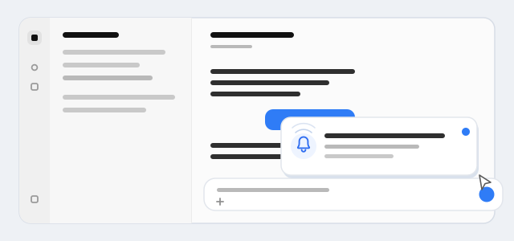

Typical use: leave the tab on a long task, switch to another application and wait for the toast instead of checking back; click it to land on the exact session. Each reminder type — finished, failed, approval, question, goal — can be turned off separately, and the conversation you are reading stays silent.

Limits: reminders for a session that has moved on expire after 90 seconds, so a late click only brings the window back; ordinary Linux desktops have no notification recall, so dismiss-on-return does not apply there; Windows persistent toasts still follow Focus Assist; subagents and internal workers stay silent by default; one session and reminder type share a cooldown so bursts do not flood.
