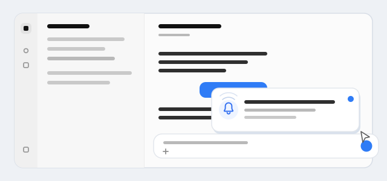

典型用法：把标签页留在长任务上，切到别的应用，靠弹出的通知判断是否值得回来；点一下直接落到出事的会话。五类提醒（完成、出错、等待审批、提问、目标完成）可以分别关闭，正在看的会话不会被打扰。

限制：会话状态变化后旧通知 90 秒过期，再点只回到页面而不强切；普通 Linux 桌面没有通知撤回通道，离开即收回在该平台不生效；Windows 的常驻通知仍受勿扰（Focus Assist）影响；子代理与内部 worker 默认静默；同一会话同一类型有冷却，避免刷屏。
